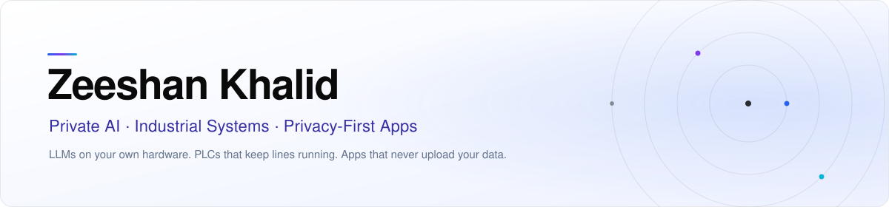
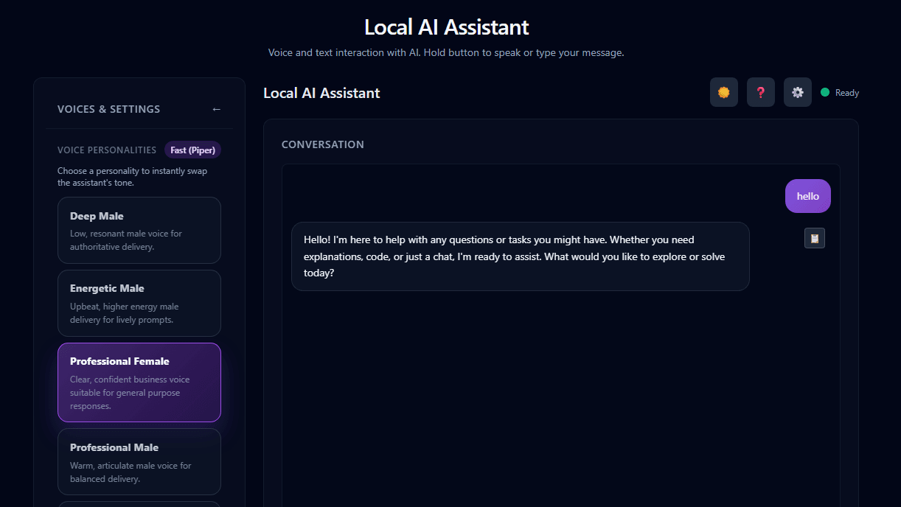

<picture>
  <source media="(prefers-color-scheme: dark)" srcset="./assets/header-dark.svg">
  
</picture>

  <a href="https://manxlr.click"><b>manxlr.click</b></a>&nbsp;&nbsp;·&nbsp;&nbsp;
  <a href="https://www.linkedin.com/in/zeeshan-khalid-3b681030/">LinkedIn</a>&nbsp;&nbsp;·&nbsp;&nbsp;
  <a href="mailto:nszeeshankhalid@gmail.com">Email</a>&nbsp;&nbsp;·&nbsp;&nbsp;
  <a href="https://apps.microsoft.com/search/publisher?name=manxlr">Microsoft Store</a>&nbsp;&nbsp;·&nbsp;&nbsp;
  <a href="https://play.google.com/store/apps/dev?id=8187565323020893418">Google Play</a>

  Research engineer · 8+ years across embedded systems, IoT, control systems and AI infrastructure · Islamabad, Pakistan

 

<table align="center" width="100%">
  <tr>
    <td width="33%" valign="top">
      <h3>Private AI</h3>
      GPU-optimised LLM servers, Open WebUI, RAG and OCR pipelines running entirely on your own hardware. Qwen, Gemma, Ollama, llama.cpp.
    </td>
    <td width="33%" valign="top">
      <h3>Industrial & IoT</h3>
      PLC programming on CODESYS and Allen-Bradley, OPC UA and Modbus to MQTT, Node-RED, servo presses, and AWS IoT telemetry.
    </td>
    <td width="33%" valign="top">
      <h3>Privacy-First Apps</h3>
      Twenty-five offline-first Windows, Android and browser apps, plus in-browser SaaS. No uploads, no accounts, no tracking.
    </td>
  </tr>
</table>

 

> I code because I want to automate everything. Automation frees us from repetitive work so we can focus on creativity and quality of life.

 

## Featured work

<table width="100%">
  <tr>
    <td width="42%" valign="top">
      
    </td>
    <td valign="top">
      <h3><a href="https://github.com/manxlr/orgenis-edge">Orgenis Edge</a></h3>
      INDUSTRIAL · OPEN SOURCE · PYTHON
      
An industrial edge runtime that turns <b>OPC UA</b> and <b>Modbus TCP</b> sources into one live <b>MQTT</b> data stream, with an embedded broker, a <b>SQLite historian</b>, and a web dashboard, admin and analytics UI. Optional Modbus TCP slave mirror and API-key-protected REST surface for downstream integration.

      
Roadmap: PROFINET · EtherNet/IP · Modbus RTU · Windows service and systemd packaging

    </td>
  </tr>
  <tr>
    <td width="42%" valign="top">
      
    </td>
    <td valign="top">
      <h3><a href="https://manxlr.click/ai-deployment">Private LLM Infrastructure</a></h3>
      AI · DEPLOYMENT · GPU
      
Complete private AI servers for teams whose data cannot leave the building. GPU-tuned deployments of <b>Qwen 2.5 / 3</b> and <b>Gemma 2 / 3</b> behind <b>Open WebUI</b>, with RAG, embedding and OCR document pipelines.

      
PyTorch · CUDA · Ollama / llama.cpp · Open WebUI · vector databases · AWS

    </td>
  </tr>
  <tr>
    <td width="42%" valign="top">
      
    </td>
    <td valign="top">
      <h3><a href="https://github.com/manxlr/AIVoice">AIVoice</a></h3>
      AI · VOICE · OPEN SOURCE
      
A local-first voice assistant you actually talk to. Microphone → <b>faster-whisper</b> → <b>LM Studio</b> → <b>Piper TTS</b>, streamed over WebSockets from a FastAPI backend. Push-to-talk, six-plus voice personalities, and nothing leaves the machine.

      
FastAPI · faster-whisper · Piper · WebSockets · LM Studio · Tailwind

    </td>
  </tr>
  <tr>
    <td width="42%" valign="top">
      
    </td>
    <td valign="top">
      <h3><a href="https://www.gamefuntastic.com/">GameFuntastic</a></h3>
      WEB · NEXT.JS · SEO
      
A production entertainment and utility hub with <b>112+ free pages</b>: 59 browser tools that process files on-device, 33 generators, games, quizzes, ebooks, a daily page and a growing library of guides. Static-first on Vercel with full structured data, sitemaps and IndexNow.

      
Next.js App Router · TypeScript · Tailwind · Vercel &nbsp;—&nbsp; <a href="https://manxlr.click/gamefuntastic">case study</a>

    </td>
  </tr>
</table>

 

## Apps

Twenty-five apps live, all built on the same rule: your files never leave your device. Full catalogue at <a href="https://manxlr.click/app-development">manxlr.click/app-development</a>.

#### On-device AI for Windows

<table width="100%">
  <tr>
    <td width="33%" valign="top"><a href="https://manxlr.click/app-development/whispering-notes-ai"><b>Whispering Notes AI</b></a> Offline audio and video transcription with Whisper, 90+ languages</td>
    <td width="33%" valign="top"><a href="https://manxlr.click/app-development/offline-subtitle-studio-ai"><b>Offline Subtitle Studio AI</b></a> Generate, edit, style and burn in subtitles — SRT, VTT, ASS</td>
    <td width="33%" valign="top"><a href="https://manxlr.click/app-development/private-ocr-studio"><b>Private OCR Studio</b></a> Scans and images into searchable PDF, Word and CSV</td>
  </tr>
  <tr>
    <td valign="top"><a href="https://manxlr.click/app-development/story-narrator-ai"><b>Story Narrator AI</b></a> AI-voiced narration with styles, ambience and local export</td>
    <td valign="top"><a href="https://manxlr.click/app-development/slumber-studio"><b>Slumber Studio</b></a> Sleep stories and guided meditations rendered up to 90 minutes</td>
    <td valign="top"><a href="https://manxlr.click/app-development/prompt-to-picture-ai"><b>Prompt to Picture AI</b></a> Text-to-image on your own GPU, no credits or subscription</td>
  </tr>
  <tr>
    <td valign="top"><a href="https://manxlr.click/app-development/upscale-studio"><b>Upscale Studio</b></a> Batch-enlarge photos up to 4×, no watermark</td>
    <td valign="top"><a href="https://manxlr.click/app-development/background-remover"><b>Background Remover</b></a> One photo or a whole folder, transparent PNG or any backdrop</td>
    <td valign="top"><a href="https://manxlr.click/app-development/ai-art-editor"><b>AI Art Editor</b></a> 65+ artistic filters with full drawing tools and 50-level undo</td>
  </tr>
</table>

<b>Windows utilities</b> &nbsp;13 more — photos, files, disks and labels

 
<table width="100%">
  <tr>
    <td width="33%" valign="top"><a href="https://manxlr.click/app-development/batchlens-pro"><b>BatchLens Pro</b></a> Convert, resize, rename and watermark photo folders — HEIC, AVIF, WebP</td>
    <td width="33%" valign="top"><a href="https://manxlr.click/app-development/diskatlas-pro"><b>DiskAtlas Pro</b></a> Interactive treemap of your drive with duplicate finder and safe cleanup</td>
    <td width="33%" valign="top"><a href="https://manxlr.click/app-development/duplicate-similar-finder-cleaner"><b>Duplicate &amp; Similar Finder</b></a> Duplicate files and near-identical images, Recycle Bin-safe</td>
  </tr>
  <tr>
    <td valign="top"><a href="https://manxlr.click/app-development/bulk-photo-watermark-exif-eraser"><b>Bulk Photo Watermark &amp; EXIF Eraser</b></a> Bulk watermarking and hidden-metadata removal</td>
    <td valign="top"><a href="https://manxlr.click/app-development/bulk-file-renamer"><b>Bulk File Renamer</b></a> Preview every new name first, undo any rename later</td>
    <td valign="top"><a href="https://manxlr.click/app-development/quickconvert"><b>QuickConvert</b></a> Multi-format batch file conversion</td>
  </tr>
  <tr>
    <td valign="top"><a href="https://manxlr.click/app-development/audio-fix-batch-converter"><b>Audio Fix Batch Converter</b></a> MP3, WAV, FLAC, AAC, OGG and WMA with quality control</td>
    <td valign="top"><a href="https://manxlr.click/app-development/ai-dream-art"><b>AI Dream Art</b></a> Offline AI artwork from text prompts</td>
    <td valign="top"><a href="https://manxlr.click/app-development/classicpad-editor"><b>ClassicPad Editor</b></a> Fast native editor for text, JSON, CSV, Markdown and logs</td>
  </tr>
  <tr>
    <td valign="top"><a href="https://manxlr.click/app-development/share-files-pc"><b>Share Files PC</b></a> Wi-Fi file sharing between PC and phone, no cloud</td>
    <td valign="top"><a href="https://manxlr.click/app-development/barcode-label-maker"><b>Barcode Label Maker</b></a> Print barcode and QR labels from Excel, CSV or a serial series</td>
    <td valign="top"><a href="https://manxlr.click/app-development/barcode-qr-code-generator"><b>Barcode &amp; QR Code Generator</b></a> Offline QR and barcode generation</td>
  </tr>
  <tr>
    <td valign="top"><a href="https://manxlr.click/app-development/shape-identifier-kids"><b>Shape Identifier for Kids</b></a> Ad-free shape-learning game for ages 4–8</td>
    <td></td>
    <td></td>
  </tr>
</table>

#### Android and browser

<table width="100%">
  <tr>
    <td width="33%" valign="top"><a href="https://play.google.com/store/apps/details?id=com.manxlr.imageinspector"><b>Image Inspector</b></a> See what your photos give away — location, device, time — and save clean copies</td>
    <td width="33%" valign="top"><a href="https://play.google.com/store/apps/details?id=com.manxlr.shrinkforge"><b>ShrinkForge</b></a> Compress to an exact size, resize and convert — no permissions, no ads</td>
    <td width="33%" valign="top"><a href="https://manxlr.gumroad.com/l/nhiap"><b>ImagePro Batch Downloader</b></a> Chrome and Edge extension for batch image extraction and conversion</td>
  </tr>
</table>

Coming soon on Android: CloakExif · Datelight · PageForge

 

## Web products

<table width="100%">
  <tr>
    <td width="33%" valign="top"><a href="https://qrbrand.app"><b>QR Brand</b></a> Privacy-first SaaS that places QR codes on images entirely in the browser. Batch export to ZIP, PNG, JPG, WebP and PDF; custom colours and logo-in-centre on Pro.</td>
    <td width="33%" valign="top"><a href="https://www.gamefuntastic.com/"><b>GameFuntastic</b></a> Entertainment and utility hub with 112+ free pages and 59 on-device browser tools. Next.js, static-first on Vercel.</td>
    <td width="33%" valign="top"><a href="https://manxlr.click"><b>manxlr.click</b></a> This portfolio: prerendered React with per-page SEO and structured data, an interactive orbit navigator, and build-time image optimisation on Netlify.</td>
  </tr>
</table>

 

## Open source

| Repository | What it is |
| :-- | :-- |
| [orgenis-edge](https://github.com/manxlr/orgenis-edge) | Industrial OPC UA and Modbus to MQTT converter with historian, web UI and REST API |
| [AIVoice](https://github.com/manxlr/AIVoice) | Local real-time voice assistant: faster-whisper, LM Studio, Piper TTS |
| [opcua-mqttbroker-mqttclient-demo](https://github.com/manxlr/opcua-mqttbroker-mqttclient-demo) | CODESYS OPC UA → Python bridge → MQTT, with Flask dashboard and desktop client |
| [games-showcase](https://github.com/manxlr/games-showcase) | Self-hosted FastAPI game library with multi-user auth, galleries and PDF export |
| [local_chatbot_lmstudio](https://github.com/manxlr/local_chatbot_lmstudio) | LM Studio chatbot with persistent sessions and message history |
| [langchaindocumentloader](https://github.com/manxlr/langchaindocumentloader) | LangChain document question-answering against a local model |

 

## Toolbox

<table width="100%">
  <tr>
    <td width="22%" valign="top"><b>Languages</b></td>
    <td valign="top">Python · TypeScript · JavaScript · C · C++ · Kotlin · Java · SQL · IEC 61131-3 Structured Text</td>
  </tr>
  <tr>
    <td valign="top"><b>AI</b></td>
    <td valign="top">PyTorch · CUDA · Ollama · llama.cpp · LM Studio · Open WebUI · faster-whisper · Piper TTS · ComfyUI · Tesseract · Apache Tika · LangChain · vector databases</td>
  </tr>
  <tr>
    <td valign="top"><b>Industrial &amp; IoT</b></td>
    <td valign="top">CODESYS · Studio 5000 (Allen-Bradley) · OPC UA · Modbus TCP · MQTT · Node-RED · Universal Robots · Keyence Vision · AWS IoT Core</td>
  </tr>
  <tr>
    <td valign="top"><b>Web &amp; apps</b></td>
    <td valign="top">Next.js · React · FastAPI · Flask · Tailwind · Jetpack Compose · Electron · SQLite · Docker · Vercel · Netlify · Firebase</td>
  </tr>
</table>

 

  Taking on select projects — private LLM deployment, industrial automation and IoT, app and web development.  
  <a href="mailto:nszeeshankhalid@gmail.com"><b>nszeeshankhalid@gmail.com</b></a>
  &nbsp;&nbsp;·&nbsp;&nbsp;
  <a href="https://manxlr.click"><b>manxlr.click</b></a>
  &nbsp;&nbsp;·&nbsp;&nbsp;
  <a href="https://www.linkedin.com/in/zeeshan-khalid-3b681030/"><b>LinkedIn</b></a>

<i>Automation is the future, and I am here to build it.</i>

